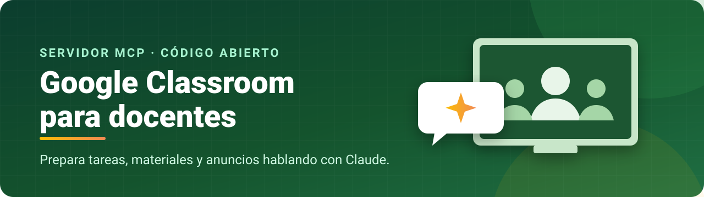

<div align="center">



# Guía de instalación

**15 minutos** la primera vez · Mac o Windows · Gratis · Sin Terminal

[← Volver al README](README.md)

</div>

---

Vas a hacer tres cosas:

1. [Crear tu llave de Google](#paso-1-tu-llave-de-google) (10 minutos, en la web de Google)
2. [Instalar la extensión en Claude Desktop](#paso-2-instalar-la-extensión) (1 minuto)
3. [Conectar tu cuenta](#paso-3-conectar-tu-cuenta) (1 minuto, desde el chat)

**Antes de empezar**, ten a mano:

- **Claude Desktop** instalado ([descárgalo aquí](https://claude.ai/download)).
- Tu **cuenta de Google del centro**, la misma con la que entras en Classroom.

> [!TIP]
> Si tienes varias cuentas de Google abiertas en el navegador (personal y del centro), haz el paso 1 en una **ventana de incógnito** y entra solo con la del centro. Así no te equivocarás de cuenta.

---

## Paso 1. Tu llave de Google

Google no deja que ninguna aplicación entre en tu Classroom sin tu permiso. Para darlo, cada docente crea su propia «llave» en Google Cloud. Es gratis, no pide tarjeta y solo se hace una vez.

Cada apartado tiene un **enlace directo** a la pantalla que necesitas.

### A. Crea el proyecto

1. Abre **[Nuevo proyecto](https://console.cloud.google.com/projectcreate)**. Si es la primera vez, acepta las condiciones.
2. En **Nombre del proyecto** escribe `Classroom MCP`.
3. Pulsa **Crear** y espera unos segundos a que termine.

> [!NOTE]
> Si aparece una oferta de «prueba gratuita de 300 $», ignórala: lo que vas a usar es gratis siempre.

### B. Activa Classroom, Drive y Slides

1. Abre **[Activar las API](https://console.cloud.google.com/flows/enableapi?apiid=classroom.googleapis.com,drive.googleapis.com,slides.googleapis.com)**.
2. Comprueba que arriba, junto al logotipo de Google Cloud, está elegido el proyecto **Classroom MCP**.
3. Pulsa **Siguiente** y después **Habilitar**.

### C. Configura la pantalla de permisos

1. Abre **[Google Auth Platform](https://console.cloud.google.com/auth/overview)** y pulsa **Comenzar**.
2. **Nombre de la aplicación**: `Classroom MCP`. **Correo de asistencia**: el tuyo. Pulsa **Siguiente**.
3. **Público**:
   - Si aparece **Interno**, elígelo. Es lo mejor: la conexión no caduca y no hay que hacer el apartado D.
   - Si no aparece (cuentas personales o algunos centros), elige **Externo**.
4. Escribe tu correo de contacto, acepta la política y pulsa **Crear**.

### D. Añádete como usuario de prueba (solo si elegiste «Externo»)

1. Abre **[Público](https://console.cloud.google.com/auth/audience)**.
2. Deja el estado en **Prueba**. No pulses «Publicar aplicación».
3. En **Usuarios de prueba**, pulsa **Add users**, escribe tu propio correo y guarda.

### E. Crea y descarga tu llave

1. Abre **[Crear cliente](https://console.cloud.google.com/auth/clients/create)**.
2. **Tipo de aplicación**: **App de escritorio**. *No* elijas «Aplicación web»: no funcionaría.
3. **Nombre**: `Claude`. Deja sin marcar cualquier otra casilla. Pulsa **Crear**.
4. En la ventana que aparece, pulsa **Descargar JSON**.

Se guardará en tu carpeta **Descargas** un archivo llamado `client_secret_….json`. Esa es tu llave: **déjala en Descargas** y no la compartas con nadie.

---

## Paso 2. Instalar la extensión

1. **[Descarga la extensión](https://github.com/vTanco/google-classroom-mcp/releases/latest/download/google-classroom-docentes.mcpb)** (archivo `google-classroom-docentes.mcpb`, unos 5 MB).
2. Haz **doble clic** en el archivo. Se abrirá Claude Desktop con una ventana de instalación.
3. Pulsa **Instalar**.

> [!TIP]
> Si el doble clic no abre Claude: abre Claude Desktop, ve a **Configuración → Extensiones** y arrastra el archivo a esa ventana.

En la ventana de la extensión verás un campo opcional, **Llave de Google**. No hace falta rellenarlo si tu llave está en Descargas. Si la guardaste en otra carpeta, elígela ahí.

---

## Paso 3. Conectar tu cuenta

Abre una **conversación nueva** en Claude y escribe:

> Conecta Classroom

Claude guardará una copia privada de tu llave y abrirá la página de Google en tu navegador:

1. **Elige tu cuenta del centro.** Si el navegador entra con otra cuenta, copia la dirección de esa pestaña y ábrela en una ventana de incógnito.
2. Si aparece «**Google no ha verificado esta aplicación**», es normal: la aplicación es tuya. Pulsa **Configuración avanzada** y después **Ir a Classroom MCP**.
3. **Marca todas las casillas** de permisos y pulsa **Continuar**.
4. Verás una página con el mensaje **«Classroom está conectado»**. Ciérrala y vuelve a Claude.

Ya puedes borrar el archivo `client_secret_….json` de Descargas: Claude tiene su copia.

---

## Paso 4. Primera prueba

Empieza por algo que solo lee:

> Lista mis cursos de Classroom.

Y después algo que no ve nadie:

> Crea en [un curso de prueba] una tarea en borrador titulada «Prueba», con entrega el viernes a las 23:59.

Ábrelo en Classroom, en la pestaña **Trabajo de clase**. Estará en **borrador**: ningún alumno lo ve. Bórralo a mano cuando quieras.

Ideas para seguir en el [README](README.md#qué-puedes-pedirle).

---

## Otras formas de instalarlo

### Con el asistente (Claude Code o sin Claude Desktop)

El asistente hace contigo los pasos 1 a 3: abre cada página de Google, espera a que descargues la llave, conecta tu cuenta y lo añade a Claude Desktop y a Claude Code (guarda una copia de seguridad de tu configuración anterior).

Necesitas **Node.js 22 o 24**: descárgalo de [nodejs.org](https://nodejs.org) (versión LTS) e instálalo. Después abre la **Terminal** (Mac) o **PowerShell** (Windows) y escribe:

```bash
npx -y google-classroom-mcp-docentes setup
```

Otros comandos útiles:

| Comando | Para qué |
|---|---|
| `npx -y google-classroom-mcp-docentes auth` | Volver a iniciar sesión con Google |
| `npx -y google-classroom-mcp-docentes doctor` | Comprobar que todo responde (no modifica nada) |

> [!NOTE]
> **Ordenadores del centro sin permisos de administrador**: en [nodejs.org](https://nodejs.org/es/download) elige el archivo comprimido (`.tar.gz` en Mac, `.zip` en Windows), descomprímelo en tu carpeta de usuario y usa la ruta completa, por ejemplo `~/node/bin/npx -y google-classroom-mcp-docentes setup`.

### Desde el código

```bash
git clone https://github.com/vTanco/google-classroom-mcp.git
cd google-classroom-mcp
npm ci --ignore-scripts
npm run setup
```

Si tu `credentials.json` está en la carpeta del proyecto, se sigue usando ahí.

---

## Si algo falla

Lo primero, pregúntale a Claude: **«¿Funciona la conexión con Classroom?»**. Te dirá qué falta y qué hacer.

| Qué pasa | Por qué y qué hacer |
|---|---|
| Ha dejado de funcionar tras unos días | Con el público **Externo** en modo **Prueba**, Google pide volver a entrar cada **7 días**. Dile a Claude **«Reconecta Classroom»** (1 minuto). Con **Interno** no pasa. |
| `Error 403: access_denied` | Elegiste **Externo** y falta añadir tu correo como usuario de prueba ([apartado D](#d-añádete-como-usuario-de-prueba-solo-si-elegiste-externo)). |
| `Error 403: org_internal` aunque tu cuenta sea del centro | A veces pasa con cuentas educativas. En [Público](https://console.cloud.google.com/auth/audience) pulsa **Marcar como externo**, deja el estado en **Prueba**, añade tu correo en usuarios de prueba y vuelve a conectar. |
| «Esta app está bloqueada» o `admin_policy_enforced` | El administrador de Google de tu centro bloquea aplicaciones externas. Pídele que marque como **de confianza** tu ID de cliente en *Consola de administración → Seguridad → Acceso y control de datos → Controles de API*. El ID está en [Clientes](https://console.cloud.google.com/auth/clients) (empieza por números y termina en `.apps.googleusercontent.com`). |
| Claude dice que la llave es de tipo «Aplicación web» | Creaste el cliente equivocado. Crea otro de tipo **App de escritorio** ([apartado E](#e-crea-y-descarga-tu-llave)) y vuelve a pedir «Conecta Classroom». |
| Claude dice que faltan permisos | No marcaste todas las casillas en la página de Google. Pide «Conecta Classroom» y márcalas todas. |
| Claude dice que falta habilitar una API | Repite el [apartado B](#b-activa-classroom-drive-y-slides) con el proyecto correcto elegido arriba. |
| Google muestra «500. Se trata de un error» | Había varias páginas de inicio de sesión abiertas a la vez. Cierra las pestañas de Google y vuelve a pedir «Conecta Classroom» una sola vez. |
| No se abre el navegador | Claude te dará el enlace: cópialo y ábrelo en tu navegador. |
| Claude no muestra la extensión | Revisa que esté activada en **Configuración → Extensiones** y abre una conversación nueva. |
| «Access denied» al editar una tarea | Google solo deja modificar lo que se creó desde Claude. Lo creado a mano en Classroom se edita a mano. |
| No puedo añadir un archivo a una tarea ya publicada | Límite de Google. Pide a Claude que cree la publicación de nuevo con todos los adjuntos y borra la antigua a mano. |

¿Algo que no esté aquí? [Abre una consulta](https://github.com/vTanco/google-classroom-mcp/issues/new/choose) contando qué pasa. No pegues nunca tu llave ni el contenido de tus archivos de sesión.
