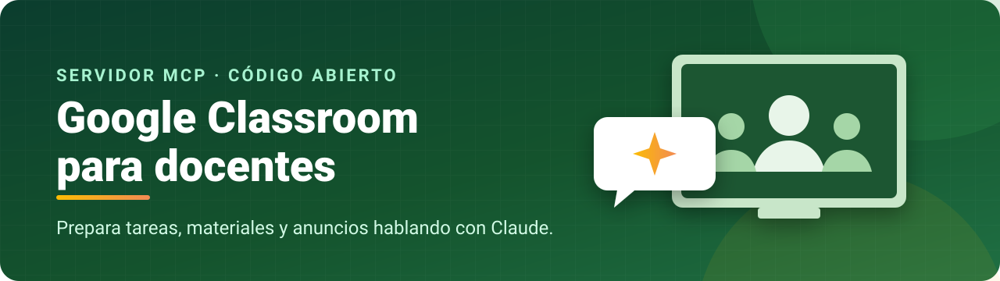

<div align="center">



# 🛠️ Guía de instalación

⏱️ **20-30 minutos** la primera vez · 💻 Mac o Windows · 🆓 Gratuito

[← Volver al README](README.md)

</div>

---

Pasos:
1. [Instalar Node.js](#1-instalar-nodejs-)
2. [Descargar y preparar el servidor](#2-descargar-y-preparar-el-servidor-)
3. [Crear tu proyecto en Google Cloud y tu `credentials.json`](#3-crear-tu-proyecto-en-google-cloud-)
4. [Autorizar tu cuenta de Google](#4-autorizar-tu-cuenta-de-google-)
5. [Conectarlo a Claude](#5-conectarlo-a-claude-)
6. [Primera prueba](#6-primera-prueba-)
7. [Solución de problemas](#7-solución-de-problemas-)

> [!TIP]
> Si usas Claude Code, puedes pegarle esta guía y pedirle que haga contigo los pasos 1, 2, 4 y 5. El paso 3 (Google Cloud) y elegir tu cuenta en el navegador tienes que hacerlos tú.

---

## 1. Instalar Node.js 📦

Necesitas **Node.js 22 o 24**.

- Descárgalo de <https://nodejs.org> (versión **LTS**) e instálalo.
- Comprueba en la Terminal (Mac) o en PowerShell (Windows):

```bash
node -v
```

Debe mostrar `v22.x` o `v24.x`.

> [!NOTE]
> **Sin permisos de administrador (ordenadores del centro):** en la página de descargas de Node.js elige el archivo comprimido (`.tar.gz` en Mac, `.zip` en Windows), descomprímelo en tu carpeta de usuario y usa la ruta completa a `node` en los pasos siguientes (p. ej. `~/node/bin/node`).

## 2. Descargar y preparar el servidor ⬇️

**Opción A — con git:**

```bash
git clone https://github.com/vTanco/google-classroom-mcp.git
cd google-classroom-mcp
npm ci --ignore-scripts
npm run build
```

**Opción B — sin git:** en la página del repositorio pulsa **Code → Download ZIP**, descomprímelo en una carpeta que no vayas a mover (p. ej. `Documentos/google-classroom-mcp`; la carpeta del ZIP se llama `google-classroom-mcp-main`, puedes renombrarla), abre una Terminal en esa carpeta y ejecuta:

```bash
npm ci --ignore-scripts
npm run build
```

Apunta la **ruta completa** de esa carpeta; la necesitarás en el paso 5. En Mac la ves con `pwd`; en Windows, con `cd`.

## 3. Crear tu proyecto en Google Cloud ☁️

Esto crea tu propia «aplicación» de Google, que es lo que permite que el servidor hable con tu Classroom. Es gratuito y no hace falta tarjeta.

> [!IMPORTANT]
> Hazlo **con la misma cuenta de Google que usas en Classroom**. Si tienes varias cuentas abiertas, usa una **ventana de incógnito** e inicia sesión solo con esa.

### 3.1 Crear el proyecto
1. Entra en <https://console.cloud.google.com> y acepta las condiciones si te las pide.
2. Arriba a la izquierda, en el **selector de proyectos**, pulsa **Nuevo proyecto**.
3. Nombre: `Classroom MCP` → **Crear**. Comprueba que queda seleccionado arriba.

> [!NOTE]
> Puedes ignorar el aviso de «prueba gratuita de 300 $»: estas APIs son gratuitas.

### 3.2 Activar las APIs
Menú ☰ → **APIs y servicios → Biblioteca**. Busca y pulsa **Habilitar** en estas tres:
- **Google Classroom API** (la del icono verde de Classroom; **no** la que se llama «Google Classroom MCP API»)
- **Google Drive API**
- **Google Slides API**

### 3.3 Pantalla de consentimiento (Google Auth Platform)
1. Menú ☰ → **APIs y servicios → Pantalla de consentimiento de OAuth** (o **Google Auth Platform**) → **Comenzar**.
2. **Nombre de la aplicación:** `Classroom MCP`. **Correo de asistencia:** el tuyo.
3. **Público:**
   - Si aparece **Interno** (cuentas de centro educativo/empresa), elígelo: no caduca y no hace falta añadir usuarios de prueba.
   - Si no aparece, elige **Externo**.
4. Correo de contacto → acepta la política → **Crear**.
5. **Solo si elegiste Externo:** ve a **Público**, deja el estado en **Prueba** (no elijas «En producción») y en **Usuarios de prueba → Add users** añade tu propio correo.

> [!WARNING]
> Si más adelante al autorizar te sale `Error 403: org_internal` aunque tu cuenta sea del mismo centro, ve a **Público → Marcar como externo → Prueba**. Ver [Solución de problemas](#7-solución-de-problemas-).

### 3.4 Crear las credenciales (`credentials.json`)
1. **Google Auth Platform → Clientes → + Crear cliente**.
2. **Tipo de aplicación: App de escritorio** (*no* «Aplicación web»: no funcionaría).
3. Nombre: `Claude`. Deja **sin marcar** «Use this client for an AI-powered agent». → **Crear**.
4. Pulsa **Descargar JSON**.
5. Mueve ese archivo a la carpeta del servidor y renómbralo a **`credentials.json`**:

Mac:
```bash
mv ~/Downloads/client_secret_*.json /RUTA/DEL/SERVIDOR/credentials.json
```

Windows (PowerShell):
```powershell
Move-Item $HOME\Downloads\client_secret_*.json C:\RUTA\DEL\SERVIDOR\credentials.json
```

> [!CAUTION]
> `credentials.json` es **tuyo**: no lo compartas. Cada docente debe crear el suyo.

## 4. Autorizar tu cuenta de Google 🔑

En la carpeta del servidor:

```bash
npm run auth
```

1. Se abrirá tu navegador predeterminado con la pantalla de Google.
2. **Elige la cuenta de tu Classroom.**
   - Si el navegador entra con otra cuenta: **copia la dirección completa** de esa pestaña, pégala en una **ventana de incógnito** e inicia sesión allí con la cuenta correcta. Funciona en cualquier navegador mientras la Terminal siga esperando.
3. Si aparece «**Google no ha verificado esta aplicación**», es normal (la app es tuya): **Configuración avanzada → Ir a Classroom MCP**.
4. **Acepta todos los permisos** (marca todas las casillas si las hay) → **Continuar**.
5. En el navegador verás «Authentication successful» y en la Terminal:

```
OAuth connection verified; token saved locally.
```

Se habrá creado `token.json` en la carpeta (tu permiso; no lo compartas).

Compruébalo sin tocar nada de tus cursos:

```bash
npm run doctor
```

Debe mostrar `Classroom API: OK` y `Drive API: OK`.

> [!WARNING]
> **No ejecutes `npm run auth` varias veces a la vez** (por ejemplo en varias pestañas): Google se lía y da error 500. Si te equivocas, cierra todas con `Ctrl + C` y lánzalo una sola vez.

## 5. Conectarlo a Claude 🔌

Necesitas dos rutas completas:
- **Node:** en Mac `which node`, en Windows `where node` (p. ej. `/usr/local/bin/node` o `C:\Program Files\nodejs\node.exe`).
- **Servidor:** la carpeta del paso 2 + `/dist/index.js`.

### Claude Code

```bash
claude mcp add google-classroom --scope user -- /RUTA/A/node /RUTA/DEL/SERVIDOR/dist/index.js
```

Abre una **sesión nueva** de Claude Code y comprueba con `/mcp` que aparece `google-classroom` conectado.

### Claude Desktop

Abre **Configuración → Desarrollador → Editar configuración** (o edita directamente el archivo):
- Mac: `~/Library/Application Support/Claude/claude_desktop_config.json`
- Windows: `%APPDATA%\Claude\claude_desktop_config.json`

Añade dentro de `"mcpServers"` (si el archivo está vacío, copia el bloque entero):

```json
{
  "mcpServers": {
    "google-classroom": {
      "command": "/RUTA/A/node",
      "args": ["/RUTA/DEL/SERVIDOR/dist/index.js"]
    }
  }
}
```

En Windows usa barras dobles: `"C:\\Users\\tu_usuario\\Documents\\google-classroom-mcp\\dist\\index.js"`.

**Cierra Claude Desktop del todo** (Cmd+Q / salir desde la bandeja) y vuelve a abrirlo.

## 6. Primera prueba ✅

En una conversación nueva, empieza por algo que solo lee:

> Lista mis cursos activos de Classroom.

Y después algo inofensivo:

> Crea un borrador de tarea en [un curso de prueba] titulada «Prueba MCP», con entrega el viernes a las 23:59.

Míralo en Classroom (pestaña **Trabajo de clase**): estará en **borrador**, sin que lo vea ningún alumno. Bórralo a mano cuando quieras.

### Ideas de uso
- «Crea el tema "Unidad 3: Electricidad" en los tres grupos de 1º y dentro una tarea "Práctica 1" de 10 puntos para el día 30.»
- «Sube como material, en el tema STRUCTURES de cada grupo, el PDF *Vocabulario.pdf* de mi Drive.» *(con Google Drive para escritorio instalado, Claude encuentra el archivo y su ID en tu Mac).*
- «Crea las prácticas 2 a 18 con la ficha de cada sesión como **copia para cada alumno**, en borrador, con entrega el día de su sesión.»
- «Programa un anuncio para el lunes a las 8:00 recordando la entrega del proyecto.»
- «Adjunta el documento de la actividad en **edición compartida** para que toda la clase trabaje en el mismo archivo.»

## 7. Solución de problemas 🩺

| Problema | Causa y solución |
|---|---|
| `Error 403: org_internal` aunque tu cuenta sea del centro | La app está como «Interno» pero Google no la acepta (a veces pasa en cuentas educativas). **Público → Marcar como externo → Prueba** y vuelve a autorizar. Si Google dice que tu cuenta «no es apta» como usuario de prueba, ignóralo y prueba a autorizar igualmente: suele funcionar. |
| `Error 403: access_denied` | Con «Externo», falta añadir tu correo en **Usuarios de prueba**. |
| `Error 403: admin_policy_enforced` o «Esta app está bloqueada» | El administrador de Google Workspace de tu centro bloquea apps externas. Pídele que marque como **de confianza** tu ID de cliente (está en `credentials.json`, campo `client_id`) en *Consola de administración → Seguridad → Acceso y control de datos → Controles de API*. |
| `Use a Desktop app OAuth client, not Web application credentials` | Creaste un cliente «Aplicación web». Crea otro de tipo **App de escritorio** (paso 3.4). |
| `Required scopes are missing` | No aceptaste todos los permisos. Repite `npm run auth` marcando todas las casillas. |
| `OAuth grant expired or revoked` / deja de funcionar tras unos días | Con la app en modo **Prueba**, Google retira el permiso a los **7 días**. Ejecuta `npm run auth` de nuevo (1 minuto). Con «Interno» no pasa. |
| `Enable the requested Classroom or Drive API` | Falta habilitar alguna API (paso 3.2), en el **mismo proyecto** del `credentials.json`. |
| Google muestra «500. Se trata de un error» | Varias autorizaciones abiertas a la vez. Cierra todas (`Ctrl + C`), cierra las pestañas de Google y `localhost`, y lanza `npm run auth` una sola vez. |
| El navegador entra con la cuenta equivocada | Copia la URL de la pestaña de Google y ábrela en incógnito con la cuenta correcta (paso 4). |
| Claude no ve las herramientas | Revisa las rutas absolutas de `node` y de `dist/index.js`, ejecuta `npm run build` y reinicia Claude (sesión nueva en Claude Code; salir del todo en Desktop). |
| «Access denied… the Google project that created the post» al editar | Google solo deja modificar por API lo que se creó con **tu** proyecto de Google Cloud. Lo creado a mano en Classroom solo se edita a mano. |
| No puedo añadir un archivo a una tarea ya publicada | Límite de la API de Classroom. Crea la publicación de nuevo con todos los adjuntos y borra la antigua a mano. |

¿Algo que no esté aquí? Abre un *issue* en el repositorio.
