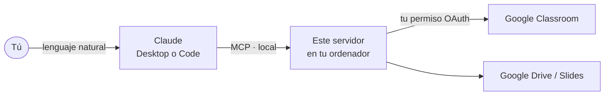

<div align="center">


<br>

**Conecta Claude con tu Google Classroom y prepara tus clases escribiendo en lenguaje normal.**

[](https://github.com/vTanco/google-classroom-mcp/actions/workflows/checks.yml)
[](LICENSE)


[**Instalación**](INSTALACION.md) · [Qué puede hacer](#qué-puede-hacer) · [Ejemplos](#ejemplos-de-uso) · [Límites](#lo-que-no-hace) · [Privacidad](#privacidad-y-seguridad) · [Problemas](INSTALACION.md#7-solución-de-problemas-)

</div>

---

## Así se usa

Le hablas a Claude como a un compañero; él crea las publicaciones en tu Classroom.

> **Tú:** Crea en *ESO 2º Tecnología* las prácticas 2 a 18, cada una con su ficha de Drive como **copia para cada alumno**, 100 puntos, entrega el día de su sesión (martes, jueves y viernes) a las 23:59. En borrador.
>
> **Claude:** Hecho: 17 tareas en borrador en el tema *Sistemas IoT*. P02 vence el mar 20 oct, … P18 el jue 26 nov. Revísalas en *Trabajo de clase* y publícalas cuando quieras.



> [!NOTE]
> Todo funciona **en tu ordenador** con **tu propia cuenta** y **tu propio proyecto de Google Cloud**. No hay servidores intermedios ni nadie más ve tus cursos.

## Qué puede hacer

<table>
<tr>
<td width="50%" valign="top">

### Cursos y temas
- Listar y buscar cursos por nombre o sección
- Ver detalles, cambiar nombre/aula o archivar
- Crear y renombrar temas

### Tareas
- Tareas y preguntas de respuesta corta
- Puntos, instrucciones, tema
- **Fecha y hora de entrega en tu hora local**

</td>
<td width="50%" valign="top">

### Materiales y adjuntos
- Materiales sin entrega
- Archivos de Drive, enlaces, YouTube y Forms
- **Modo de cada archivo:** solo lectura, edición compartida o **copia para cada alumno**

### Anuncios y publicación
- Anuncios en el tablón
- Todo en **borrador** por defecto
- Publicación inmediata o **programada**

</td>
</tr>
</table>

<details>
<summary><b>Ver las 21 herramientas</b></summary>

| Área | Herramientas |
|---|---|
| Cursos | `classroom_list_courses`, `classroom_search_courses`, `classroom_get_course`, `classroom_update_course` |
| Temas | `classroom_list_topics`, `classroom_get_topic`, `classroom_create_topic`, `classroom_patch_topic` |
| Tareas | `classroom_list_assignments`, `classroom_get_assignment`, `classroom_create_assignment`, `classroom_patch_assignment` |
| Materiales | `classroom_list_materials`, `classroom_get_material`, `classroom_create_material`, `classroom_patch_material` |
| Anuncios | `classroom_list_announcements`, `classroom_post_announcement`, `classroom_patch_announcement` |
| Drive / Slides | `drive_upload_file` (hasta 5 MB), `slides_get_presentation` |

Adjuntos de Drive con `shareMode`: `VIEW` (por defecto), `EDIT` o `STUDENT_COPY` (solo en tareas).

</details>

## Ejemplos de uso

| Quieres… | Pídeselo así |
|---|---|
| Ver tus clases | «Lista mis cursos activos de Classroom.» |
| Organizar una unidad | «Crea el tema *Unidad 3: Electricidad* en los tres grupos de 1º.» |
| Subir material | «Sube el PDF *Vocabulario.pdf* de mi Drive como material en el tema *STRUCTURES* de cada grupo pluri.» |
| Fichas individuales | «Crea la tarea *Práctica 05*, 10 puntos, con la ficha como **copia para cada alumno**, entrega el viernes.» |
| Trabajo colaborativo | «Adjunta el documento de la actividad en **edición compartida** para toda la clase.» |
| Avisar a la clase | «Programa un anuncio para el lunes a las 8:00 recordando la entrega del proyecto.» |
| Corregir fechas | «Retrasa una sesión las entregas de las prácticas 8 a 18.» |

> [!TIP]
> Con **Google Drive para escritorio** instalado, Claude encuentra tus archivos en el Mac/PC y los adjunta por su nombre sin que tengas que buscar enlaces.

## Instalación rápida

> [!IMPORTANT]
> Cada docente necesita **su propio `credentials.json`** de Google Cloud (gratuito). La [guía completa](INSTALACION.md) lo explica pantalla a pantalla, unos 20-30 minutos la primera vez.

```bash
git clone https://github.com/vTanco/google-classroom-mcp.git
cd google-classroom-mcp
npm ci --ignore-scripts && npm run build
# copia aquí tu credentials.json (ver INSTALACION.md, paso 3)
npm run auth      # elige tu cuenta de Classroom en el navegador
npm run doctor    # comprueba que todo responde
```

Y conéctalo a Claude:

<details>
<summary><b>Claude Code</b></summary>

```bash
claude mcp add google-classroom --scope user -- /ruta/a/node /ruta/a/google-classroom-mcp/dist/index.js
```

</details>

<details>
<summary><b>Claude Desktop</b></summary>

En `claude_desktop_config.json` (Configuración → Desarrollador → Editar configuración):

```json
{
  "mcpServers": {
    "google-classroom": {
      "command": "/ruta/a/node",
      "args": ["/ruta/a/google-classroom-mcp/dist/index.js"]
    }
  }
}
```

</details>

## Lo que no hace

| Límite | Motivo |
|---|---|
| No borra nada | A propósito: borrar se hace a mano en Classroom. |
| No pone notas ni ve entregas | A propósito: fuera del alcance de los permisos. |
| No crea preguntas tipo test | Usa un Google Form adjunto. |
| No cambia adjuntos de algo ya publicado | Límite de la API de Classroom: hay que crear la publicación de nuevo. |
| Solo edita lo que ha creado él | Límite de Google: lo creado a mano en Classroom no se puede modificar por API. |

## Privacidad y seguridad

- El servidor se ejecuta **en local** (stdio) y habla directamente con las APIs de Google.
- `credentials.json` y `token.json` se quedan en tu ordenador y están en `.gitignore`. **No los compartas.**
- **Permisos que pide:** cursos, tareas, materiales, temas y anuncios de Classroom; `drive.file` (archivos que sube la app) y `drive.readonly` (leer tus archivos para adjuntarlos).
- Puedes retirar el acceso en cualquier momento en [myaccount.google.com/permissions](https://myaccount.google.com/permissions).

## Desarrollo

```bash
npm ci --ignore-scripts
npm test         # compila y ejecuta los tests (sin conexión a Google)
npm run doctor   # comprueba credenciales con lecturas inocuas
```

Tras cambiar el código: `npm run build` y reinicia Claude. Contribuciones bienvenidas: abre un *issue* o un *pull request*.

## Créditos

Fork de **[pengusto/google-classroom-mcp](https://github.com/pengusto/google-classroom-mcp)**, basado en el trabajo de Adrià Santacreu i Giménez. Licencia **MIT** ([LICENSE](LICENSE)). Documentación original en inglés: [docs/README-original.md](docs/README-original.md).

**Novedades de este fork** ([CHANGELOG](CHANGELOG.md)): arreglo de la autenticación, fechas de entrega en hora local, modo de los adjuntos (`shareMode`), scripts con `npm`, dependencias actualizadas y guía en español.

<div align="center">
<sub>Proyecto no oficial, sin afiliación con Google ni Anthropic. Hecho por y para docentes.</sub>
</div>
