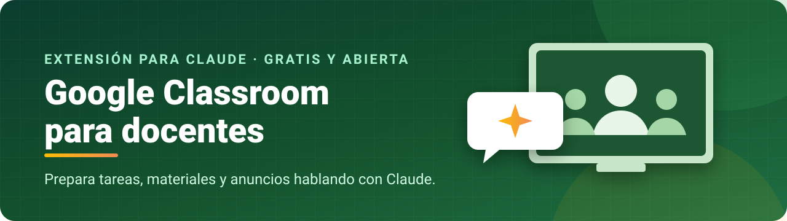
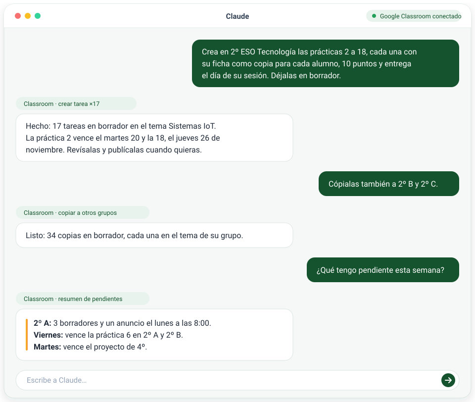
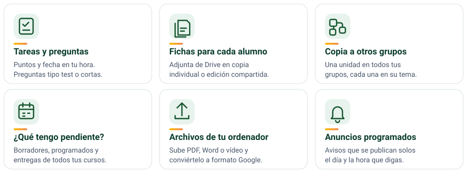
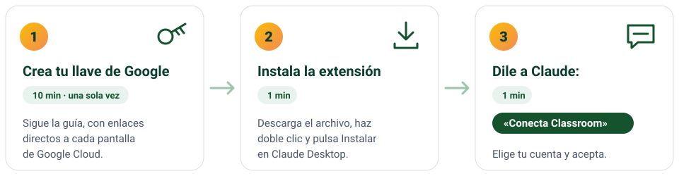
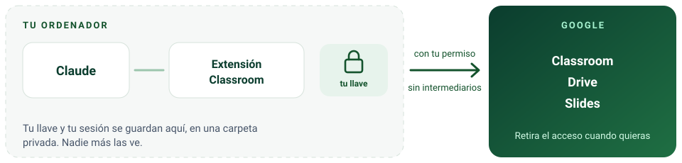

<div align="center">



<br>

**Prepara tu Google Classroom hablando con Claude, como si se lo pidieras a un compañero.**

[](https://github.com/vTanco/google-classroom-mcp/actions/workflows/checks.yml)
[](https://www.npmjs.com/package/google-classroom-mcp-docentes)


[](https://github.com/vTanco/google-classroom-mcp/blob/main/LICENSE)

[Instalar](#instalación) · [Qué puede hacer](#qué-puede-hacer) · [Si algo falla](#si-algo-falla) · [Privacidad](#privacidad) · [Guía paso a paso](https://github.com/vTanco/google-classroom-mcp/blob/main/INSTALACION.md)

</div>

---

<p align="center">
  
</p>

<p align="center"><b>Todo se crea en borrador.</b> Nada llega a tus alumnos hasta que tú lo publicas o se lo pides expresamente a Claude.</p>

## Qué puede hacer

<p align="center">
  
</p>

Háblale como a un compañero. Algunos ejemplos:

| Para… | Pídeselo así |
|---|---|
| Saber qué tienes pendiente | «¿Qué tengo en borrador o programado? ¿Qué entregas vencen esta semana?» |
| Crear tareas | «Crea la tarea *Práctica 5*, 10 puntos, para el viernes a las 23:59, en el tema *Unidad 3*.» |
| Fichas para cada alumno | «Adjunta la ficha *Práctica 5* de mi Drive como copia para cada alumno.» |
| Trabajo en grupo | «Adjunta el documento del proyecto en edición compartida para toda la clase.» |
| Preguntas rápidas | «Haz una pregunta tipo test: ¿Qué componente almacena energía? Opciones: resistencia, condensador, diodo.» |
| Subir archivos | «Sube *Apuntes tema 4.pdf* de Descargas y publícalo como material en 1º A.» |
| Formato Google | «Sube *Rúbrica.docx* convertida a Documento de Google y adjúntala editable.» |
| Buscar en Drive | «Busca en mi Drive las presentaciones que se llamen *electricidad*.» |
| Repetir en varios grupos | «Copia el material *Vocabulario* a 1º B, 1º C y 1º D.» |
| Avisar a la clase | «Programa un anuncio para el lunes a las 8:00 recordando traer la calculadora.» |
| Cambiar fechas | «Retrasa una semana las entregas de las prácticas 8 a 12.» |

## Instalación

<p align="center">
  
</p>

Necesitas **[Claude Desktop](https://claude.ai/download)** (Mac o Windows) y tu **cuenta de Google del centro**. No hace falta instalar nada más ni abrir la Terminal.

**1. Crea tu llave de Google.** Google pide que cada docente cree su propia llave gratuita para que Claude pueda entrar en su Classroom. La [guía paso a paso](https://github.com/vTanco/google-classroom-mcp/blob/main/INSTALACION.md#paso-1-tu-llave-de-google) te lleva directamente a cada pantalla. Al terminar tendrás un archivo `client_secret_….json` en tu carpeta Descargas: déjalo ahí.

**2. Instala la extensión.** Descárgala, haz doble clic en el archivo y pulsa **Instalar** en Claude Desktop.

<p align="center">
  <a href="https://github.com/vTanco/google-classroom-mcp/releases/latest/download/google-classroom-docentes.mcpb"></a>
</p>

Si el doble clic no abre Claude, ve a **Configuración → Extensiones** en Claude Desktop y arrastra el archivo a esa ventana.

**3. Conecta tu cuenta.** En una conversación nueva, escribe **«Conecta Classroom»**. Se abrirá Google en tu navegador: elige tu cuenta del centro y **marca todas las casillas** de permisos. Si Google avisa de que la aplicación no está verificada, es normal (la aplicación es tuya): pulsa *Configuración avanzada → Ir a Classroom MCP*.

Para comprobarlo, pídele: «Lista mis cursos de Classroom».

<details>
<summary><b>¿Usas Claude Code o no tienes Claude Desktop?</b></summary>

<br>

Un asistente hace los tres pasos contigo: abre cada página de Google, detecta la llave descargada, conecta tu cuenta y lo añade a Claude Desktop y a Claude Code. Necesita [Node.js](https://nodejs.org) 22 o 24 (versión LTS). En la Terminal (Mac) o PowerShell (Windows):

```bash
npx -y google-classroom-mcp-docentes setup
```

Más opciones en la [guía de instalación](https://github.com/vTanco/google-classroom-mcp/blob/main/INSTALACION.md#otras-formas-de-instalarlo).

</details>

## Novedades de la versión 3.1

- **Instalación en un clic** en Claude Desktop, sin Node.js ni Terminal.
- **Conexión desde el chat**: «Conecta Classroom» y, cuando caduque, «Reconecta Classroom».
- **Resumen de pendientes** de todos tus cursos en una sola pregunta.
- **Copia a otros grupos** con sus adjuntos, en borrador y en el tema correcto.
- **Preguntas tipo test**, **búsqueda en Drive** y **subida de archivos** de tu ordenador (hasta 100 MB) con conversión a formato Google.
- **Mensajes claros en español** que dicen qué falta y cómo arreglarlo.

Historial completo en el [CHANGELOG](https://github.com/vTanco/google-classroom-mcp/blob/main/CHANGELOG.md).

## Si algo falla

Pregúntale a Claude **«¿Funciona la conexión con Classroom?»**. Comprobará qué falta y te dirá qué hacer. Los casos más habituales:

| Qué pasa | Qué hacer |
|---|---|
| Deja de funcionar tras unos días | Es normal si tu llave está en modo «Prueba»: Google pide volver a entrar cada 7 días. Dile a Claude **«Reconecta Classroom»**. |
| Google dice «Esta app está bloqueada» | El administrador de Google de tu centro bloquea aplicaciones externas. [Qué pedirle](https://github.com/vTanco/google-classroom-mcp/blob/main/INSTALACION.md#si-algo-falla). |
| Google dice `Error 403: access_denied` | Falta añadir tu correo como usuario de prueba ([apartado D de la guía](https://github.com/vTanco/google-classroom-mcp/blob/main/INSTALACION.md#d-añádete-como-usuario-de-prueba-solo-si-elegiste-externo)). |
| No puede editar una tarea | Google solo deja modificar lo que se creó desde Claude. Lo creado a mano se edita a mano. |

¿Otro problema? Consulta la [lista completa](https://github.com/vTanco/google-classroom-mcp/blob/main/INSTALACION.md#si-algo-falla) o [abre una consulta](https://github.com/vTanco/google-classroom-mcp/issues/new/choose).

## Lo que no hace

| Límite | Por qué |
|---|---|
| No borra nada | A propósito: borrar se hace a mano en Classroom. |
| No pone notas ni ve entregas de alumnos | A propósito: no pide permiso para ver datos de alumnos. |
| No crea cuestionarios de varias preguntas | Classroom admite una pregunta por publicación. Para un examen, adjunta un Google Forms. |
| No añade archivos a algo ya publicado | Límite de Google. Claude puede crear la publicación de nuevo con todos los adjuntos. |
| Solo edita lo que ha creado él | Límite de Google: lo creado a mano en Classroom se edita a mano. |

## Privacidad

<p align="center">
  
</p>

- **Todo funciona en tu ordenador**, con tu cuenta y tu propia llave. No hay servidores intermedios.
- **Permisos que pide**: gestionar los cursos, temas, tareas, materiales y anuncios que impartes; leer tus archivos de Drive para adjuntarlos, y crear archivos cuando le pides subir uno. No pide acceso a notas, entregas ni datos de alumnos.
- Solo sube archivos de Descargas, Documentos, Escritorio o tus carpetas de nube; nunca de otras partes del ordenador.
- Retira el acceso cuando quieras en [myaccount.google.com/permissions](https://myaccount.google.com/permissions).

## Fiabilidad

- **33 pruebas automáticas** en cada cambio, en Node.js 22 y 24, sin tocar cursos reales: inicio de sesión, permisos, fechas en tu hora local, copias entre grupos, subidas de archivos y mensajes de error.
- **Probado con Google real** en una cuenta docente con 11 cursos.
- **Revisión de seguridad** en cada cambio: búsqueda de secretos con Gitleaks y auditoría de dependencias sin avisos graves.
- Las herramientas que escriben nunca reintentan solas, para no crear duplicados.

<details>
<summary><b>Para usuarios avanzados</b></summary>

### Otras instalaciones

Con npx en cualquier cliente MCP:

```json
{
  "mcpServers": {
    "google-classroom": { "command": "npx", "args": ["-y", "google-classroom-mcp-docentes"] }
  }
}
```

Comandos: `npx -y google-classroom-mcp-docentes setup` (asistente), `auth` (volver a iniciar sesión) y `doctor` (comprobar sin modificar nada). Desde el código: `git clone`, `npm ci --ignore-scripts`, `npm run setup`.

### Configuración

| Variable | Para qué |
|---|---|
| `GOOGLE_CLASSROOM_MCP_HOME` | Carpeta de la llave y la sesión. Por defecto, `~/.config/google-classroom-mcp-docentes`. |
| `GOOGLE_CREDENTIALS_PATH`, `GOOGLE_TOKEN_PATH` | Rutas exactas de la llave y de la sesión. |
| `GOOGLE_CLASSROOM_UPLOAD_DIRS` | Carpetas desde las que se permite subir archivos, separadas por `:` (`;` en Windows). |

### Las 26 herramientas

| Área | Herramientas |
|---|---|
| Conexión | `classroom_status`, `classroom_connect` |
| Cursos | `classroom_list_courses`, `classroom_search_courses`, `classroom_get_course`, `classroom_update_course`, `classroom_get_overview` |
| Temas | `classroom_list_topics`, `classroom_get_topic`, `classroom_create_topic`, `classroom_patch_topic` |
| Tareas y preguntas | `classroom_list_assignments`, `classroom_get_assignment`, `classroom_create_assignment`, `classroom_patch_assignment`, `classroom_copy_post` |
| Materiales | `classroom_list_materials`, `classroom_get_material`, `classroom_create_material`, `classroom_patch_material` |
| Anuncios | `classroom_list_announcements`, `classroom_post_announcement`, `classroom_patch_announcement` |
| Drive y Slides | `drive_search_files`, `drive_upload_file`, `slides_get_presentation` |

Los adjuntos de Drive aceptan `shareMode`: `VIEW` (solo lectura, por defecto), `EDIT` (un archivo compartido) o `STUDENT_COPY` (copia para cada alumno; solo en tareas).

### Desarrollo

```bash
npm ci --ignore-scripts
npm test             # compila y ejecuta las pruebas, sin conexión a Google
npm run build:mcpb   # genera build/google-classroom-docentes.mcpb
```

Al publicar una etiqueta `v*`, GitHub Actions genera la extensión y la adjunta a la *release*. Más detalles en [CONTRIBUTING.md](https://github.com/vTanco/google-classroom-mcp/blob/main/CONTRIBUTING.md).

</details>

## Créditos

Basado en [pengusto/google-classroom-mcp](https://github.com/pengusto/google-classroom-mcp) y en el trabajo de Adrià Santacreu i Giménez. Licencia [MIT](https://github.com/vTanco/google-classroom-mcp/blob/main/LICENSE).

<p align="center"><sub>Proyecto no oficial, sin relación con Google ni con Anthropic. Hecho por y para docentes.</sub></p>
