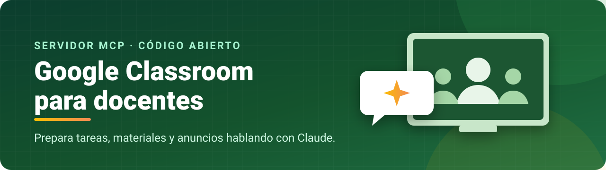

<div align="center">



<br>

**Prepara tu Google Classroom hablando con Claude, como si se lo pidieras a un compañero.**

[](https://github.com/vTanco/google-classroom-mcp/actions/workflows/checks.yml)
[](https://www.npmjs.com/package/google-classroom-mcp-docentes)
[](LICENSE)


[**Instalar**](#instalación-en-3-pasos) · [Qué puedes pedirle](#qué-puedes-pedirle) · [Si algo falla](#si-algo-falla) · [Privacidad](#privacidad) · [Guía paso a paso](INSTALACION.md)

</div>

---

## Así se usa

> **Tú:** Crea en *2º ESO Tecnología* las prácticas 2 a 18, cada una con su ficha de Drive como **copia para cada alumno**, 10 puntos, con entrega el día de su sesión a las 23:59. Déjalas en borrador.
>
> **Claude:** Hecho: 17 tareas en borrador en el tema *Sistemas IoT*. La práctica 2 vence el martes 20 de octubre y la 18, el jueves 26 de noviembre. Revísalas en *Trabajo de clase* y publícalas cuando quieras.

> **Tú:** Cópialas también a 2º B y 2º C.
>
> **Claude:** Listo: 34 copias en borrador, cada una en el tema *Sistemas IoT* de su grupo.

> **Tú:** ¿Qué tengo pendiente esta semana?
>
> **Claude:** En 2º A tienes 3 borradores sin publicar y un anuncio programado para el lunes a las 8:00. El viernes vencen la práctica 6 (2º A y 2º B) y el proyecto de 4º.

> [!NOTE]
> **Todo se crea en borrador**: nada llega a tus alumnos hasta que tú lo publiques o se lo pidas expresamente a Claude.

## Qué puedes pedirle

| Para… | Pídeselo así |
|---|---|
| **Ver tus clases** | «Lista mis cursos de Classroom.» |
| **Saber qué tienes pendiente** | «¿Qué tengo en borrador o programado? ¿Qué entregas vencen esta semana?» |
| **Crear tareas** | «Crea la tarea *Práctica 5*, 10 puntos, para el viernes a las 23:59, en el tema *Unidad 3*.» |
| **Fichas para cada alumno** | «Adjunta la ficha *Práctica 5* de mi Drive como **copia para cada alumno**.» |
| **Trabajo en grupo** | «Adjunta el documento del proyecto en **edición compartida** para toda la clase.» |
| **Preguntas rápidas** | «Haz una pregunta tipo test: ¿Qué componente almacena energía? Opciones: resistencia, condensador, diodo.» |
| **Subir archivos de tu ordenador** | «Sube *Apuntes tema 4.pdf* de Descargas y publícalo como material en 1º A.» |
| **Convertir a formato Google** | «Sube *Rúbrica.docx* convertida a Documento de Google y adjúntala editable.» |
| **Buscar en tu Drive** | «Busca en mi Drive las presentaciones que se llamen *electricidad*.» |
| **Repetir en varios grupos** | «Copia el material *Vocabulario* a 1º B, 1º C y 1º D.» |
| **Organizar por temas** | «Crea los temas *Unidad 1*, *Unidad 2* y *Unidad 3* en los tres grupos de 1º.» |
| **Avisar a la clase** | «Programa un anuncio para el lunes a las 8:00 recordando traer la calculadora.» |
| **Cambiar fechas** | «Retrasa una semana las entregas de las prácticas 8 a 12.» |

## Instalación en 3 pasos

Necesitas **Claude Desktop** ([descárgalo aquí](https://claude.ai/download), Mac o Windows) y tu **cuenta de Google del centro**. No hace falta instalar nada más ni usar la Terminal.

### 1. Crea tu llave de Google · 10 minutos, una sola vez

Google pide que cada docente cree su propia «llave» gratuita para que Claude pueda entrar en su Classroom. Se hace en la web de Google Cloud siguiendo la **[guía paso a paso](INSTALACION.md#paso-1-tu-llave-de-google)**, con enlaces directos a cada pantalla.

Al terminar tendrás un archivo llamado `client_secret_….json` en tu carpeta **Descargas**. Déjalo ahí.

### 2. Instala la extensión en Claude Desktop · 1 minuto

1. **[Descarga la extensión](https://github.com/vTanco/google-classroom-mcp/releases/latest/download/google-classroom-docentes.mcpb)** (archivo `google-classroom-docentes.mcpb`).
2. Haz **doble clic** en el archivo descargado. Se abrirá Claude Desktop.
3. Pulsa **Instalar**.

> [!TIP]
> Si el doble clic no abre Claude, ve a **Claude → Configuración → Extensiones** y arrastra el archivo a esa ventana.

### 3. Conecta tu cuenta · 1 minuto

Abre una conversación nueva en Claude y escribe:

> **Conecta Classroom**

Claude encontrará tu llave en Descargas y abrirá la página de Google en tu navegador:

1. Elige tu **cuenta del centro**.
2. Si Google avisa de que la aplicación «no está verificada», es normal: la aplicación es tuya. Pulsa **Configuración avanzada → Ir a Classroom MCP**.
3. **Marca todas las casillas** de permisos y pulsa **Continuar**.

Vuelve a Claude y pídele: «Lista mis cursos de Classroom». Si los ves, ya está todo listo.

<details>
<summary><b>¿Usas Claude Code o no tienes Claude Desktop?</b></summary>

<br>

Hay un asistente que hace los pasos 1 a 3 contigo: abre cada página de Google, detecta la llave descargada, conecta tu cuenta y lo añade a Claude Desktop y a Claude Code. Necesita **Node.js 22 o 24** ([descárgalo aquí](https://nodejs.org), versión LTS).

Abre la Terminal (Mac) o PowerShell (Windows) y escribe:

```bash
npx -y google-classroom-mcp-docentes setup
```

Más opciones en la [guía de instalación](INSTALACION.md#otras-formas-de-instalarlo).

</details>

## Si algo falla

Pregúntale a Claude:

> **¿Funciona la conexión con Classroom?**

Claude comprobará qué falta y te dirá exactamente qué hacer. Los casos más habituales:

| Qué pasa | Qué hacer |
|---|---|
| Ha dejado de funcionar tras unos días | Es normal si tu llave está en modo «Prueba»: Google pide volver a entrar cada 7 días. Dile a Claude **«Reconecta Classroom»** (1 minuto). |
| Google dice «Esta app está bloqueada» | El administrador de Google de tu centro bloquea aplicaciones externas. [Qué pedirle](INSTALACION.md#si-algo-falla). |
| Google dice `Error 403: access_denied` | Falta añadir tu correo como usuario de prueba ([paso D de la guía](INSTALACION.md#d-añádete-como-usuario-de-prueba-solo-si-elegiste-externo)). |
| Claude dice que no puede editar una tarea | Google solo deja modificar lo que se creó desde Claude. Lo creado a mano en Classroom se edita a mano. |

¿Otro problema? Mira la [lista completa](INSTALACION.md#si-algo-falla) o [abre una consulta](https://github.com/vTanco/google-classroom-mcp/issues/new/choose).

## Lo que no hace

| Límite | Por qué |
|---|---|
| **No borra nada** | A propósito: borrar se hace a mano en Classroom. |
| **No pone notas ni ve las entregas de los alumnos** | A propósito: no pide permiso para ver datos de alumnos. |
| **No crea cuestionarios de varias preguntas** | Classroom solo permite una pregunta por publicación. Para un examen, adjunta un Google Forms. |
| **No añade archivos a algo ya publicado** | Límite de Google. Claude puede crear la publicación de nuevo con todos los adjuntos. |
| **Solo edita lo que ha creado él** | Límite de Google: lo creado a mano en Classroom solo se edita a mano. |

## Privacidad

- **Todo funciona en tu ordenador**, con tu cuenta y tu propia llave de Google. No hay servidores intermedios: nadie más ve tus cursos.
- Tu llave y tu sesión se guardan solo en tu ordenador, en una carpeta privada a la que solo tu usuario tiene acceso. No las compartas.
- **Permisos que pide**: gestionar los cursos, temas, tareas, materiales y anuncios que tú impartes; leer tus archivos de Drive para poder adjuntarlos, y crear archivos en Drive cuando le pides subir uno. No pide acceso a notas, entregas ni datos de alumnos.
- Puedes retirar el acceso cuando quieras en [myaccount.google.com/permissions](https://myaccount.google.com/permissions).
- Claude solo sube archivos de tus carpetas Descargas, Documentos, Escritorio o de tu nube (OneDrive, Google Drive para escritorio, iCloud), nunca de otras partes del ordenador.

<details>
<summary><b>Para usuarios avanzados</b></summary>

### Otras instalaciones

**Con npx en cualquier cliente MCP**:

```json
{
  "mcpServers": {
    "google-classroom": { "command": "npx", "args": ["-y", "google-classroom-mcp-docentes"] }
  }
}
```

Comandos para la terminal: `npx -y google-classroom-mcp-docentes setup` (asistente), `auth` (volver a iniciar sesión) y `doctor` (comprobar sin modificar nada).

**Desde el código**: `git clone`, `npm ci --ignore-scripts`, `npm run setup`.

### Configuración

| Variable | Para qué |
|---|---|
| `GOOGLE_CLASSROOM_MCP_HOME` | Carpeta de la llave y la sesión. Por defecto, `~/.config/google-classroom-mcp-docentes`. |
| `GOOGLE_CREDENTIALS_PATH`, `GOOGLE_TOKEN_PATH` | Rutas exactas de la llave y de la sesión. |
| `GOOGLE_CLASSROOM_UPLOAD_DIRS` | Carpetas desde las que se permite subir archivos, separadas por `:` (`;` en Windows). |

### Las 26 herramientas

| Área | Herramientas |
|---|---|
| Conexión | `classroom_status`, `classroom_connect` |
| Cursos | `classroom_list_courses`, `classroom_search_courses`, `classroom_get_course`, `classroom_update_course`, `classroom_get_overview` |
| Temas | `classroom_list_topics`, `classroom_get_topic`, `classroom_create_topic`, `classroom_patch_topic` |
| Tareas y preguntas | `classroom_list_assignments`, `classroom_get_assignment`, `classroom_create_assignment`, `classroom_patch_assignment`, `classroom_copy_post` |
| Materiales | `classroom_list_materials`, `classroom_get_material`, `classroom_create_material`, `classroom_patch_material` |
| Anuncios | `classroom_list_announcements`, `classroom_post_announcement`, `classroom_patch_announcement` |
| Drive y Slides | `drive_search_files`, `drive_upload_file`, `slides_get_presentation` |

Los adjuntos de Drive aceptan `shareMode`: `VIEW` (solo lectura, por defecto), `EDIT` (un archivo compartido) o `STUDENT_COPY` (copia para cada alumno; solo en tareas).

### Desarrollo

```bash
npm ci --ignore-scripts
npm test             # compila y ejecuta los tests, sin conexión a Google
npm run build:mcpb   # genera build/google-classroom-docentes.mcpb
```

Al publicar una etiqueta `v*`, GitHub Actions genera la extensión y la adjunta a la *release*. Más detalles en [CONTRIBUTING.md](CONTRIBUTING.md).

</details>

## Créditos

Basado en **[pengusto/google-classroom-mcp](https://github.com/pengusto/google-classroom-mcp)** y en el trabajo de Adrià Santacreu i Giménez. Licencia **MIT** ([LICENSE](LICENSE)). Novedades en el [CHANGELOG](CHANGELOG.md).

<div align="center">
<sub>Proyecto no oficial, sin relación con Google ni con Anthropic. Hecho por y para docentes.</sub>
</div>
